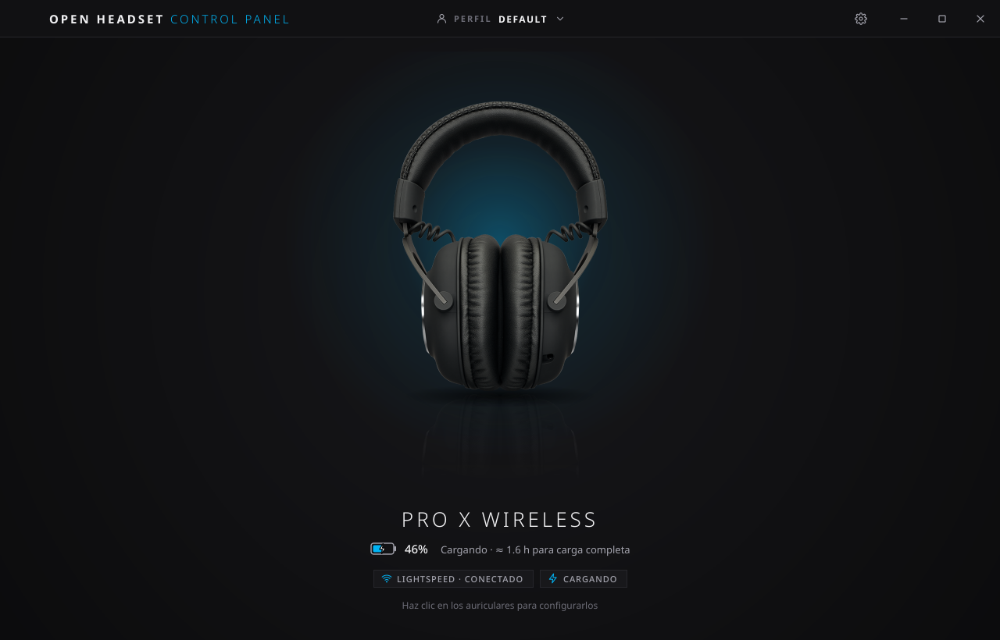
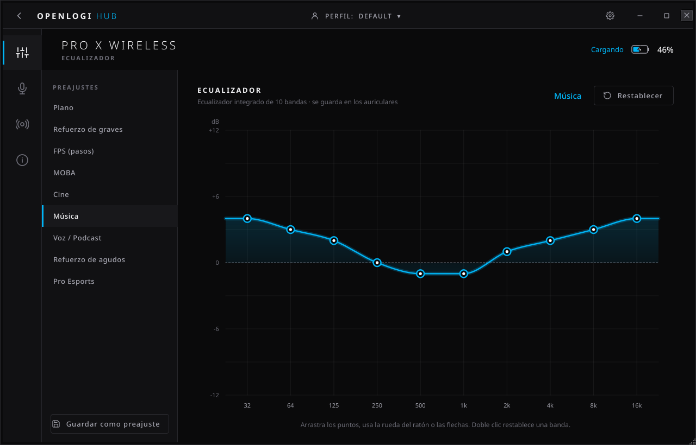
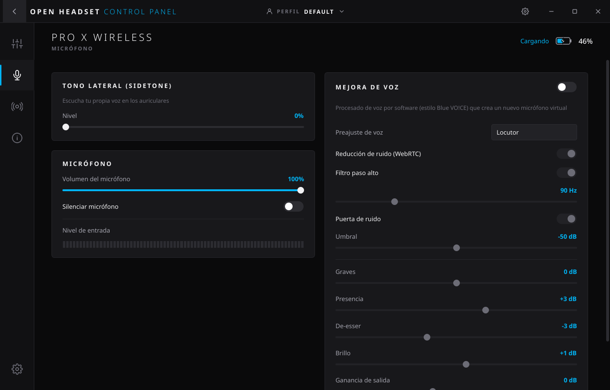
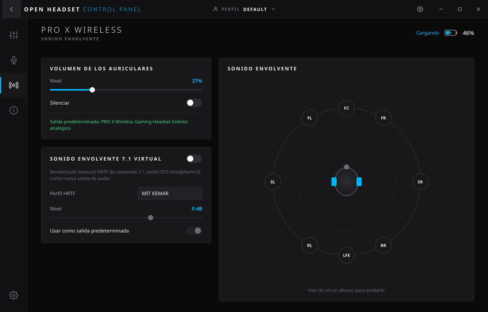
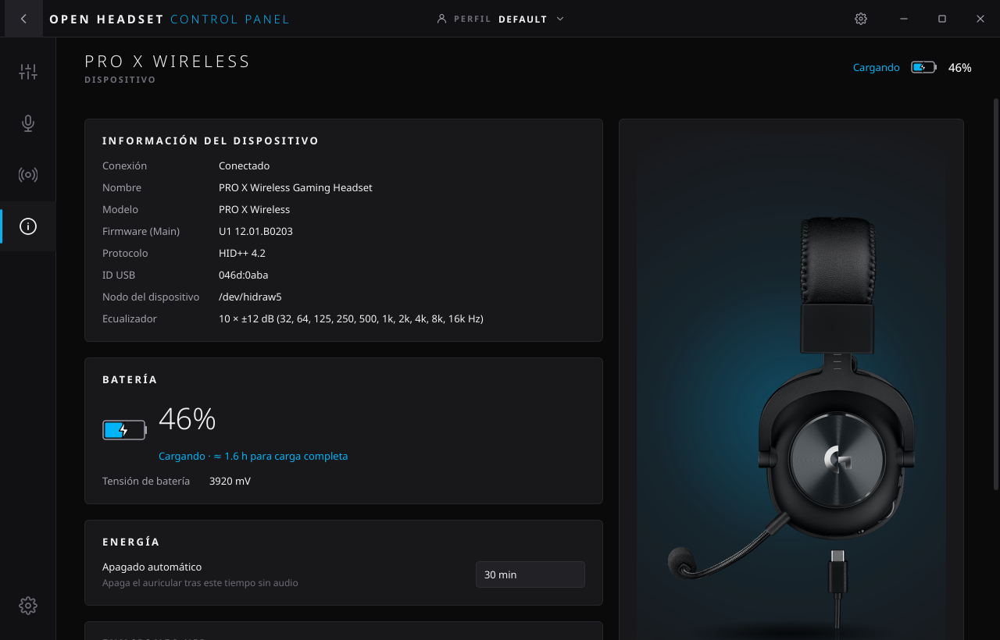

# OpenLogi Headset

Panel de control para **Logitech G PRO X Wireless LIGHTSPEED** en Linux, con un aspecto muy cercano a **Logitech G HUB**.
Habla HID++ 2.0 directamente con el auricular a través de `/dev/hidraw` (sin hidapi, sin código compilado) y se integra con PipeWire para las funciones de audio que en Windows hace G HUB por software.



| Ecualizador | Micrófono |
|---|---|
|  |  |
| **Sonido envolvente** | **Dispositivo** |
|  |  |

## Funciones

### Hardware (HID++ 2.0, en el propio auricular)
| Función | Feature HID++ | Notas |
|---|---|---|
| **Ecualizador de 10 bandas** | `0x8310` | 32 Hz – 16 kHz, ±12 dB. Gráfico interactivo: arrastrar, rueda, teclado, doble clic para resetear banda. 9 preajustes + preajustes propios. |
| **Sidetone** (oírte a ti mismo) | `0x8300` | 0–100 %. |
| **Batería** | `0x1F20` (ADC) | Tensión real en mV, estado de carga, estimación %, horas restantes/para carga completa. Eventos en tiempo real + sondeo configurable. |
| **Identidad / firmware** | `0x0003`, `0x0005` | Nombre, tipo, versión de firmware (p. ej. `U1 12.01.B0203`), protocolo HID++. |
| **Cable de carga USB** | — | Detecta el auricular enchufado por USB (`046d:0abb`). |

Estas son **todas** las funciones que expone el firmware de la primera versión del PRO X Wireless (la app enumera el árbol de features en cada conexión; ver la pestaña *Dispositivo*). HeadsetControl, por ejemplo, intenta configurar un "inactive time" en el índice 7 que este firmware no tiene (responde `INVALID_FEATURE_INDEX`).

### Software (equivalentes a G HUB sobre PipeWire)
- **Mejora de voz** (estilo *Blue VO!CE*): crea un micrófono virtual con reducción de ruido WebRTC, filtro paso alto, puerta de ruido, graves/presencia/de-esser/brillo y ganancia. 5 preajustes. Los cambios de parámetros se aplican **en vivo** (`pw-cli set-param`) sin cortar la grabación de Discord/OBS.
- **Sonido envolvente 7.1 virtual** (estilo *DTS Headphone:X*): sink virtual de 8 canales renderizado con HRTF (SOFA, `libmysofa`) a binaural en el auricular. Mapa de altavoces clicable para probar cada canal.
- **Volumen / silencio** de salida y micrófono del auricular, con sincronización en tiempo real (la rueda de volumen física se refleja al instante).
- Al activar voz/7.1 puede convertirse en dispositivo predeterminado; al desactivarlo **restaura el que tenías antes**.

### Aplicación
- **Perfiles** (crear, duplicar, renombrar, borrar) con EQ + sidetone + voz + envolvente. Se **reaplican al conectar** el auricular (el firmware guarda el EQ en RAM).
- **Bandeja del sistema** con icono que muestra la batería, menús rápidos de EQ/sidetone/perfil/voz/7.1, avisos de conexión y de batería baja.
- Inicio con la sesión, inicio minimizado, instancia única, español/inglés (sección **Ajustes** del menú lateral).
- Avisos de batería baja (umbral configurable) y de carga completada.
- **Actualizaciones automáticas**: comprueba GitHub al iniciar y cada 6 h. Con un clic se actualiza igual que se instaló: el AppImage se sustituye a sí mismo, y los paquetes .deb/.rpm/Arch se instalan con `pkexec`. Todas las descargas se verifican con `SHA256SUMS`. Mientras el repositorio sea privado, usa la sesión de `gh` si existe (o `GH_TOKEN`).
- Detecta cuando el auricular envía **silencio digital** (micro silenciado con el botón o brazo mal insertado) y lo avisa.
- **CLI** para scripts (reemplazo de `headsetcontrol` para este modelo).

## Instalación

Descarga el instalable de tu distro desde la [última release](https://github.com/blzkz/openLogiHeadsetControlPanel/releases/latest). Todos los paquetes nativos instalan la regla udev, así que el auricular funciona sin root nada más instalar.

| Distro | Archivo | Comando |
|---|---|---|
| Debian 13+, Ubuntu 24.04+, Mint, Pop!_OS | `openlogi-headset_X.Y.Z-1_all.deb` | `sudo apt install ./openlogi-headset_*_all.deb` |
| Fedora | `openlogi-headset-X.Y.Z-1.noarch.rpm` | `sudo dnf install ./openlogi-headset-*.noarch.rpm` |
| openSUSE Tumbleweed | `openlogi-headset-X.Y.Z-1.noarch.rpm` | `sudo zypper install --allow-unsigned-rpm ./openlogi-headset-*.noarch.rpm` |
| Arch, Manjaro, CachyOS, EndeavourOS | `openlogi-headset-X.Y.Z-1-any.pkg.tar.zst` | `sudo pacman -U ./openlogi-headset-*-any.pkg.tar.zst` (o [`packaging/PKGBUILD`](packaging/PKGBUILD) con `makepkg -si`) |
| Cualquier otra | `OpenLogi_Headset-X.Y.Z-x86_64.AppImage` | `chmod +x OpenLogi_Headset-*.AppImage && ./OpenLogi_Headset-*.AppImage` |

El **AppImage** incluye su propio Python y Qt; del sistema solo usa PipeWire (`pipewire`, `pactl`, `pw-cli`). Como no puede instalar la regla udev por sí solo, si no tiene acceso al auricular la pantalla de inicio muestra un botón **Conceder acceso** que la instala con `pkexec`. La CLI del AppImage se usa así: `./OpenLogi_Headset-*.AppImage ctl -b`.

Cada release se construye en GitHub Actions, y antes de publicarse se instala de verdad en contenedores limpios de Debian 13, Ubuntu 24.04, Fedora, openSUSE Tumbleweed y Arch, con una prueba de humo sin pantalla (además del AppImage en Ubuntu 22.04). Junto a los paquetes se publican el wheel de Python, el sdist y `SHA256SUMS`.

### Desde el código

Requisitos: Python ≥ 3.10, PyQt6 (con QtSvg y QtMultimedia), PipeWire + `pactl` y `libmysofa` para el 7.1.

```bash
python3 -m openlogi          # ejecutar sin instalar
./install.sh                 # instalación por usuario en ~/.local (./install.sh --uninstall)
```

Regla udev manual (si no usas un paquete):

```bash
sudo install -m644 packaging/70-openlogi-headset.rules /etc/udev/rules.d/ && sudo udevadm control --reload && sudo udevadm trigger
```

### Construir los instalables

```bash
packaging/build-packages.sh 1.2.3     # .deb, .rpm y .pkg.tar.zst en dist/ (requiere nfpm)
packaging/appimage/build.sh 1.2.3     # AppImage en dist/
```

Para publicar una versión basta con crear una release `vX.Y.Z` en GitHub. El workflow `Release` compila, prueba y adjunta los instalables.

## Uso

```
openlogi-headset [--minimized] [--page equalizer|mic|surround|info] [-v]
```

CLI:

```bash
openlogi-headsetctl -i                      # info + estado
openlogi-headsetctl -b                      # batería: "44% (charging)"
openlogi-headsetctl -s 30                   # sidetone 30 %
openlogi-headsetctl -p bass_boost           # preajuste de EQ
openlogi-headsetctl -e 4,3,2,0,-1,-1,1,2,3,4  # EQ manual (dB)
openlogi-headsetctl --list-presets
openlogi-headsetctl -i --json
```

(`python3 -m openlogi ctl …` equivale a `openlogi-headsetctl …`). La CLI usa un *software ID* HID++ distinto, así que si la GUI está abierta **refleja al instante** los cambios hechos desde la CLI.

## Arquitectura

```
openlogi/
├── hidpp/            Protocolo HID++ 2.0 puro (transporte hidraw, mensajes, errores, features tipadas)
├── device.py         Descubrimiento del receptor y modelo de alto nivel del auricular
├── service.py        Hilo de fondo: reconexión, keepalive, eventos, escrituras coalescidas (latest-wins)
├── battery.py        Curva de descarga Li-ion + suavizado
├── audio/            PipeWire: pactl, cadena de voz, 7.1 virtual (procesos `pipewire -c` aislados)
├── config.py         Perfiles y ajustes (JSON atómico en ~/.config/openlogi-headset)
├── cli.py            Interfaz de línea de comandos
└── ui/               PyQt6: tema G HUB, widgets propios (gráfico EQ, mapa 7.1, vúmetro…), páginas, bandeja
```

Detalles de diseño:
- **Sin índices de feature fijos**: todo se resuelve con `IRoot.getFeature` → resiste cambios de firmware.
- **Escrituras coalescidas**: arrastrar un slider genera decenas de eventos; el servicio solo envía el último valor pendiente, sin bloquear la UI.
- **Nada de hilos de UI bloqueados**: HID en un hilo, audio (`pactl`, `pw-cli`) en otro con cola por clave.
- **Los efectos de audio no tocan tu configuración de PipeWire**: cada efecto es un proceso `pipewire -c` privado que se crea/destruye al vuelo; si la app muere, el siguiente arranque limpia procesos huérfanos.
- Tests: `python3 -m unittest discover -s tests` (auricular simulado byte a byte con las respuestas reales).

## Notas de protocolo (PRO X Wireless, receptor `046d:0aba`)

Interfaz 3 del receptor, página de uso `0xFF43`, solo informes HID++ largos (`0x11`, 20 bytes), índice de dispositivo `0xFF`, HID++ 4.2.

| Índice | Feature | Funciones usadas |
|---|---|---|
| 0 | `0x0000` Root | `getFeature`, `ping` |
| 1 | `0x0001` FeatureSet | `getCount`, `getFeatureId` |
| 2 | `0x0003` DeviceFWVersion | `getEntityCount`, `getFwInfo` |
| 3 | `0x0005` DeviceName | `getCount`, `getName`, `getType` (=8, headset) |
| 4 | `0x8310` Equalizer | `fn0` info → `[bands=10, range=12, caps, …]`; `fn1(start)` → `start` + hasta 7 frecuencias BE16; `fn2(0)` → ganancias int8; `fn3` → **`[0x02, g1…g10]`** (0x00/0x01/0x03 → `INVALID_ARGUMENT`; |g| > 12 → `INVALID_ARGUMENT`) |
| 5 | `0x8300` Sidetone | `fn0` get, `fn1(level 0–100)` set |
| 6 | `0x1F20` ADC | `fn0` → `[mV BE16, flags]` (`0x01` en uso, `0x03` cargando); eventos con el mismo formato |

## Limitaciones conocidas
- El porcentaje de batería es una **estimación** a partir de la tensión (el firmware no da %); durante la carga se compensa la sobretensión.
- El firmware no expone apagado automático ni el estado del botón de mute del micro.
- Con PipeWire < 1.4 (p. ej. Ubuntu 24.04) la puerta de ruido de la mejora de voz se omite automáticamente porque ese PipeWire no tiene el filtro `noisegate`. El resto de la cadena funciona igual.
- Probado con la primera versión (receptor `0aba`). Los IDs `0aaa` y el PRO Wireless `0aa7` están incluidos porque usan la misma familia de protocolo, pero no se han probado.

## Licencia
GPL-3.0-or-later. Proyecto independiente, **sin afiliación con Logitech**. Las imágenes del producto (`openlogi/assets/images`) son © Logitech, se usan solo para identificar el dispositivo y no están cubiertas por la licencia del código.
